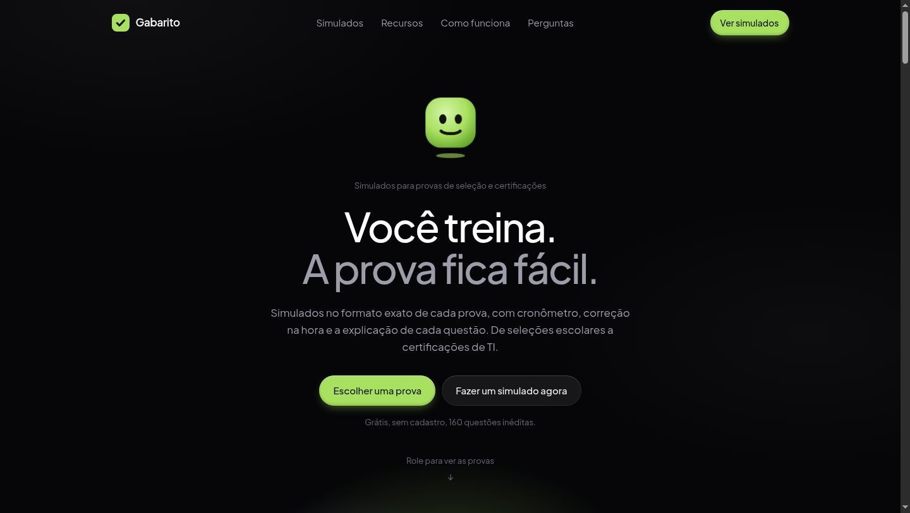
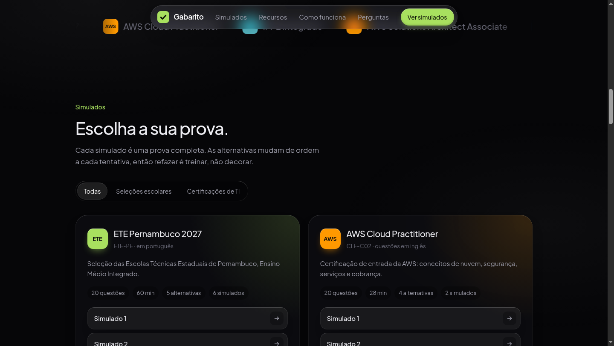
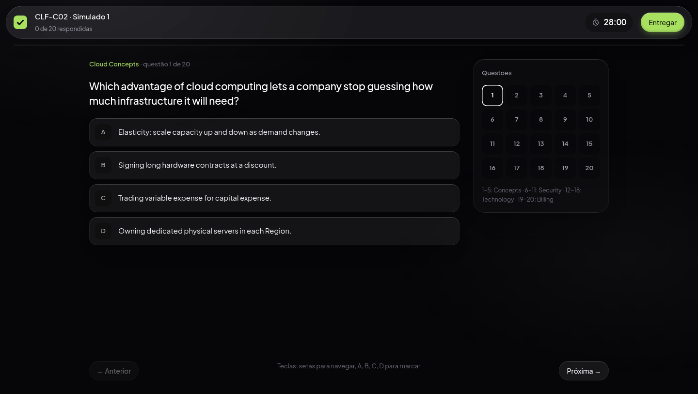

<div align="center">

# ✅ Gabarito

**Simulados no formato exato da prova, com correção explicada.**  
Seleções escolares e certificações de TI · Grátis · Sem cadastro.

[](https://github.com/mateuseap/gabarito/actions/workflows/ci.yml)
[](https://github.com/mateuseap/gabarito/actions/workflows/publish-images.yml)
[](LICENSE)
[](https://gabarito.lab.mateuseap.com)



</div>

---

## Por que o Gabarito?

Quem chega numa prova sem ter treinado no ritmo dela perde pontos por tempo, não por conteúdo. O Gabarito reproduz cada prova como ela é: o número de questões, de alternativas, o tempo, a divisão por matéria ou domínio e a regra de aprovação. No fim mostra a nota, o que revisar e a explicação de cada questão.

- **Formato real.** Cada prova tem o seu formato, com a fonte oficial citada.
- **Correção explicada.** Toda questão traz o porquê da resposta certa.
- **Sem cadastro.** O progresso fica salvo só no navegador. Não há conta nem servidor.
- **Feito para crescer.** Uma prova nova é uma entrada no catálogo e um arquivo de questões.

## Provas

| Prova | Formato do simulado | Simulados | Fonte |
|--|--|--|--|
| 🟩 **ETE Pernambuco 2027** | 20 questões, 5 alternativas, 60 min, 10 Português + 10 Matemática | 6 | [Edital ETE 2027.1](https://www.educacaoprofissional.org/selecao/downloads/3/EDITAL-ETE-INTEGRADO-2027_.pdf) |
| 🟧 **AWS Cloud Practitioner (CLF-C02)** | 20 questões, 4 alternativas, 28 min, domínios 24/30/34/12% | 2 | [Exam Guide CLF-C02](https://d1.awsstatic.com/training-and-certification/docs-cloud-practitioner/AWS-Certified-Cloud-Practitioner_Exam-Guide.pdf) |

Na fila: IFPE Integrado, ENEM, AWS Solutions Architect Associate e Microsoft Azure Fundamentals.

A ETE é uma prova única para as 71 Escolas Técnicas Estaduais de Pernambuco, inclusive a ETE José Humberto de Moura Cavalcanti, em Limoeiro. O simulado da AWS mantém o ritmo da prova real (65 questões em 90 minutos) e a proporção de domínios; a nota de 100 a 1000 é uma estimativa, porque a AWS usa um modelo de pontuação próprio.

Todas as questões são inéditas, escritas a partir do conteúdo oficial. O Gabarito não tem vínculo com a SEE-PE, a AWS ou outras bancas.



## Funcionalidades

|  |  |
|--|--|
| ⏱ **Cronômetro de prova** | O tempo não pausa, avisa nos últimos 5 minutos e entrega sozinho no fim |
| 🔀 **Alternativas embaralhadas** | A ordem muda a cada tentativa, então refazer não é decorar a letra |
| ⌨️ **Atalhos de teclado** | Setas para navegar entre questões, A a E para marcar |
| 🧭 **Mapa de questões** | Pular entre questões e ver o que já foi respondido |
| 📊 **Resultado por matéria** | Nota no formato da prova, acertos por matéria ou domínio, aviso de eliminação ou de aprovação |
| 🎯 **O que revisar** | Os assuntos do edital ou do guia oficial em que houve erro |
| 📈 **Meu painel** | Página própria em `#/painel`, aberta pelo topo do site, pelo resultado de cada simulado e pela prévia na página inicial. Abas Progresso (gráfico e dias de estudo), Histórico (cada simulado com link para o resultado), Conteúdo (assuntos de cada prova) e Revisar (assuntos com erro em todas as tentativas, cada um levando à correção). Cada aba tem endereço próprio. Dá para baixar ou apagar o histórico. Tudo no navegador |



## Design

O visual segue a referência de [heysusi.app](https://heysusi.app): fundo quase preto, superfícies de vidro com brilho interno, destaque verde-limão e a fonte Plus Jakarta Sans. Medidas e movimentos foram tirados da página real:

- página de 1120 px, seções a cada 160 px, títulos de 64 e 40 px com peso 500;
- cabeçalho transparente que vira uma pílula de vidro flutuante ao rolar;
- faixa de logos em loop de 48 s com esmaecimento de 96 px nas bordas;
- cards de recursos em carrossel contínuo: desliza sozinho em loop, pausa ao passar o mouse, com setas nas bordas, arraste com o mouse e brilho que segue o cursor;
- seções que aparecem subindo 24 px ao entrar na tela, com a curva `cubic-bezier(.32, .72, 0, 1)`.

## Adicionar provas e simulados

O catálogo é o ponto de extensão. Nada na interface é específico de uma prova.

- **Mais um simulado de uma prova existente:** acrescente um bloco de questões em cada arquivo de disciplina (por exemplo `src/data/portugues.js` e `src/data/matematica.js`). O simulado aparece sozinho.
- **Outra prova:** crie o arquivo de questões e acrescente uma entrada em `PROVAS`, em `src/data/catalogo.js`, com formato, regras, fonte, disciplinas e as funções `avaliar` e `nota`.

Cada questão tem `topico`, `enunciado`, `certa`, `erradas`, `explicacao` e, opcionalmente, `texto` (o texto-base). Os testes em `test/conteudo.test.js` garantem, para todas as provas, que cada simulado tem o tamanho do formato, que nenhuma questão tem alternativa repetida e que nenhum enunciado se repete. Também conferem as regras do edital da ETE e os pesos de domínio da AWS.

## Desenvolvimento

```bash
pnpm install
pnpm dev      # http://localhost:5173
pnpm test
pnpm build
```

Site estático feito com Vite, sem framework. A imagem Docker roda os testes, compila e serve com nginx. Cada push na `main` publica `ghcr.io/mateuseap/gabarito`, e o [homelab](https://github.com/mateuseap/homelab) roda o site em [gabarito.lab.mateuseap.com](https://gabarito.lab.mateuseap.com).

## Licença

MIT. Veja [LICENSE](LICENSE).
